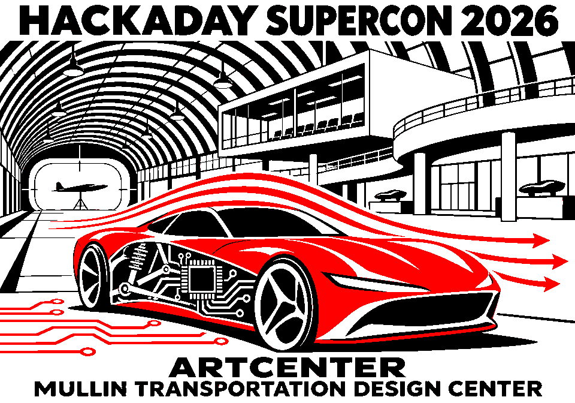

# Supercon 2026 Badge Slideshow

A simple, offline CircuitPython image slideshow for the Hackaday Supercon 2026 Billboard Badge. Drop BMP files into an `images` folder and set the pause between pictures in `refresh.txt`.



## Hardware and firmware

- Hackaday Supercon 2026 Billboard Badge, ESP32-S3-WROOM-1-N8R8.
- Tested display: 960 × 672 pixels, red/black/white e-paper, panel variant 1.
- Tested firmware: CircuitPython `11.0.0-alpha.2-104-g1f239f06b2-dirty`, board ID `hackaday_supercon2026`, dated November 6, 2026.
- Uses built-in `board` and `displayio`; no additional libraries, network connection, or credentials are needed.

This project assumes compatible CircuitPython is already installed and the badge appears as the `CIRCUITPY` USB drive. It does not include firmware or flashing tools. Compatibility with other panels or firmware builds has not been verified.

### Badge CircuitPython firmware project

The firmware project used for this badge is [Scott Shawcroft's (tannewt) CircuitPython fork, `hackaday_supercon2026` branch](https://github.com/tannewt/circuitpython/tree/hackaday_supercon2026).

The tested badge was flashed with a `.bin` shared on Discord and reported the version above. This link points to the source project; it is not a verified download of that exact binary. The branch may change over time.

## Install

1. Download this repository using **Code → Download ZIP**, then extract it.
2. Connect the badge by USB and open `CIRCUITPY`.
3. Back up any existing `code.py`, `refresh.txt`, and `images` folder you want to keep.
4. Copy this repository's `code.py`, `refresh.txt`, and `images` folder to the root of `CIRCUITPY`.
5. Allow the program to reload and the e-paper display to finish refreshing.

The badge should contain:

```text
CIRCUITPY/
├── code.py
├── refresh.txt
└── images/
    ├── 01-supercon-ten.bmp
    └── ...
```

The `previews` folder is for browsing artwork on GitHub; it does not need to be copied to the badge. Seven included BMPs use about 4.52 MB in total. Check available space before copying them to a badge with other files.

## Change the timing

Edit `refresh.txt` in the root of `CIRCUITPY`:

```text
# Seconds to hold a picture after its refresh finishes.
# Use exactly one whole number from 1 to 86400.
30
```

Blank lines and `#` comments are allowed, including a comment after the number. The program reads this setting after each successful display update. Missing or invalid settings fall back to 30 seconds.

**This is a hold time, not a guaranteed total cycle time.** The display's refresh duration and driver cooldown add time. The program waits for the display driver before starting another refresh.

## Add your own images

- Recommended size: **960 pixels wide × 672 pixels high**.
- Use uncompressed **8-bit indexed BMP** with black (`#000000`), white (`#FFFFFF`), and red (`#FF0000`). The included graphics use this format.
- Copy files into `CIRCUITPY/images`. PNG and JPEG files are not used by this slideshow.
- Images are shown in filename order. Numbered filenames make the order easy to control.
- Smaller images are centered on white. Oversized images are skipped; the program does not resize them.
- The folder is scanned again after each pass. Saving over USB can trigger CircuitPython auto-reload.

## Included artwork

1. Supercon Ten
2. Badge Hacking
3. Rover
4. Quantum Chandelier
5. Woven Circuits
6. Electronic Phoenix
7. Mullin Transportation Design Center — automotive design, electronics, and wind-tunnel-inspired airflow.

The custom artwork was created with AI assistance and prepared for this three-color display. It is unofficial community artwork. The seventh illustration takes inspiration from [ArtCenter's description of the Mullin Center](https://www.artcenter.edu/connect/dot-magazine/articles/darin-johnstone-architects-mullin-transportation-design-center.html); it is a stylized interpretation rather than an architectural rendering. Hackaday, Supercon, and ArtCenter names belong to their respective owners. This project is not affiliated with or endorsed by them.

## Troubleshooting

- **Slow or flashing screen:** e-paper updates can take tens of seconds. Wait for the refresh to finish.
- **No images:** confirm the folder is named `images`, contains BMP files, and sits beside `code.py`.
- **An image is skipped:** check its dimensions and BMP encoding. A serial console can show the reported error.
- **Safe mode / hard crash:** this project was tested on an alpha firmware build. Record the safe-mode reason and firmware version before troubleshooting. Repeated resets are not a confirmed fix.
- **Restore your previous program:** replace the slideshow files with your saved copies.

## Sharing and contributions

Bug reports should include the board ID, firmware version, display dimensions, and console error, without passwords or other private information.

## License

This project uses the [MIT License](LICENSE), a permissive license commonly used for Adafruit CircuitPython code. You may use, modify, and redistribute the code and documentation, including commercially, provided you keep the copyright and license notice. It is provided without warranty.

The included custom artwork is also offered under the same MIT terms, to the extent the project contributors hold rights in it. Third-party names and trademarks remain the property of their owners; this license does not grant trademark rights. The artwork was created with AI assistance, as noted above.

License and copyright headers follow [Adafruit's CircuitPython contribution guidance](https://learn.adafruit.com/contribute-to-circuitpython-with-git-and-github/add-author-and-license-information). Copyright is credited to this project's owner, not Adafruit. Firmware and third-party dependencies retain their own licenses.
